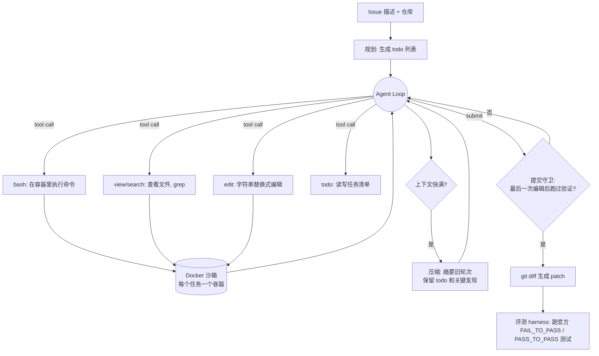

# P2 · Nano Coding Agent：仓库级自动修 Bug

> 状态：M0 完成；hard2 任务集（pass@1 72%）可用于消融（2026-10-30），见第 16 节进展记录。
> 位置：项目文件已收纳到 `pri/Codingagent/`（代码、任务集、实验产物、本文档），见该目录 README。
> 前置：`src/miniagent` 的 agent loop 已能跑通（第 1 周练习）。
> 主力模型：`gpt-6-luna`（中转站 api.gpt.ge），chat/completions + `reasoning_effort=none`（开推理时该接口不支持工具调用）。

## 1. 现实需求

Claude Code、Cursor、字节 Trae、腾讯 CodeBuddy 这类 Coding Agent 是目前大厂投入最多的 Agent 方向。真实需求是：给一个 GitHub issue 和一个代码仓库，Agent 自己定位问题、改代码、跑测试，直到测试通过，产出一个 patch。

本项目从零（不用 LangChain 之类框架）实现一个精简版 Coding Agent，在**隔离沙箱**中运行，并在业界标准评测集 **SWE-bench**（Lite 或 Verified 的子集）上测量解决率。它和你现在 `src/miniagent` 的 agent loop 一脉相承，是最顺的第一个项目。

## 2. 目标、范围与完成标准

**要证明的三件事**（简历和面试都围绕它们）：

1. 我能从零写出一个**可用**的 Coding Agent：在沙箱里读代码、改代码、跑测试、提交 patch。
2. 我能**量化**它：在标准评测集上有 baseline 解决率，有成本和耗时数字。
3. 我能**改进**它：每个改进都有消融实验，说得清“为什么变好、好了多少、代价是什么”。

**不做的事**（防止范围失控）：不做 IDE 插件 / Web 前端（trace 可视化除外）；不训练模型；不追 SOTA 分数——用便宜模型拿到“有 baseline、有提升、有归因”的结果就够了；不支持 Python 以外的语言（游戏配置表变体除外，见第 12 节）。

**完成标准（Definition of Done）**：

- [ ] 玩具集（≥20 题）解决率 ≥ 80%，单命令可复现：`python -m nanocoder.bench --suite toy`
- [ ] SWE-bench Lite / Verified 固定子集（50 题）跑出 baseline，并有 ≥3 组消融实验，每组 k=3 次重复
- [ ] 每题有完整 trace（JSONL）和可浏览的 trace 页面
- [ ] 一份评测报告：解决率、pass^3、平均轮数 / token / 成本 / 耗时、失败归因分布
- [ ] README 写清复现步骤；简历条目中的 X / Y 全部替换成真实数字

## 3. 对应 JD

- 腾讯 AI Coding / Agent 研发：任务拆解、代码生成、测试执行
- 米哈游 AI 研发（游戏方向）：基于 Agent 的研发工具链（代码审查、自动化测试、配置生成）
- 字节、阿里：Agent 工程化、上下文管理、评测

## 4. 架构



说明：架构图里没有 `run_tests` 工具。SWE-bench 的官方测试（FAIL_TO_PASS）对 Agent 是**隐藏的**，Agent 只能自己写复现脚本、或用 `bash` 跑仓库里已有的测试。把隐藏测试透露给 Agent 属于**数据泄漏**，结果作废。

## 5. 技术栈

- Python 3.11、OpenAI 兼容接口（自己写 loop，不依赖 agent 框架）
- 复用 `src/miniagent`：`llm.py`（重试/超时）、`tools.py`（`@tool` + `ToolRegistry`，错误以字符串返回给模型）、`trace.py`（JSONL 追踪）
- Docker（`docker` Python SDK）做沙箱；资源限制（CPU、内存、超时、禁网可选）
- 数据集：`princeton-nlp/SWE-bench_Lite`（300 题）或 `princeton-nlp/SWE-bench_Verified`（500 题），先取 20～50 题子集
- 评测：SWE-bench 官方 harness（`swebench` 包）
- 参考实现：`mini-swe-agent`（SWE-agent 团队的极简实现，只有一个 bash 工具、约百行核心）、SWE-agent（提出 ACI——Agent-Computer Interface 概念）、OpenHands —— 先读懂再自己写

## 6. 代码结构（规划）

```
src/nanocoder/
  sandbox.py       # Sandbox 抽象：LocalSandbox（M0）/ DockerSandbox（M1+）
  tools.py         # bash / view / search / edit / todo / submit，绑定到某个 sandbox
  agent.py         # CodingAgent：loop、步数/成本上限、提交守卫
  context.py       # 输出截断、观察遮蔽、LLM 摘要压缩
  prompts.py       # system prompt / 实例 prompt 模板（版本号写进 trace）
  patch.py         # 从容器取 git diff，剔除测试文件和临时脚本
  bench/
    tasks.py       # Task 数据结构；toy 和 SWE-bench 两种加载器
    runner.py      # 并发跑任务、重试、断点续跑（跳过已有结果）
    evaluate.py    # toy：自己跑测试；SWE-bench：调官方 harness
    report.py      # 汇总 JSON → Markdown 报告 + 消融表
    viewer.py      # trace → 单文件 HTML
benchmarks/toy/    # 20+ 个玩具任务
runs/<run_id>/     # 每次实验的配置、predictions.jsonl、traces/、results.json（git 忽略）
```

与 `miniagent` 的关系：`miniagent` 的工具直接在宿主机执行；这里每个任务新建一个 `ToolRegistry`，工具函数用闭包绑定当前任务的 `sandbox`，loop 本身不用知道沙箱的存在。

## 7. 关键设计

### 7.1 Agent Loop

- 每轮：调用模型 → 若有 `tool_calls` 逐个执行（按顺序，不并行，避免两个编辑互相覆盖）→ 结果作为 `tool` 消息追加。
- 终止条件（任一触发）：模型调用 `submit` 且通过提交守卫；达到 `max_steps`（默认 50）；累计成本超过 `cost_limit`（默认每题 ¥2，可配）；墙钟超时（默认 20 分钟）。超限时**仍然提交当前 diff**（可能部分正确），并在结果里记录 `exit_reason`。
- 模型既不调用工具也不 submit（只回文字）：追加一条提醒“请调用工具继续，或调用 submit 结束”，连续 3 次则终止，`exit_reason=no_action`。
- 所有异常（模型 4xx、容器挂掉）都写进结果，不让单题失败拖垮整批。

### 7.2 工具规格

| 工具 | 参数 | 行为与关键错误信息 |
|---|---|---|
| `bash` | `command`, `timeout=120` | 在容器 `/testbed` 下执行；超时则杀进程并返回“命令超时（120s），考虑加 `-x` / 只跑单个测试”；输出超 10k 字符时保留头 4k + 尾 4k，中间写明省略了多少行 |
| `view` | `path`, `start_line?`, `end_line?` | 带行号显示；单次最多 300 行；目录则列出两层结构；路径不存在时给出相近文件名 |
| `search` | `pattern`, `path="."`, `glob?` | 基于 `grep -rn`（容器里有 `rg` 就用 `rg`）；最多 50 条，超出提示“结果过多，请缩小范围” |
| `edit` | `path`, `old_str`, `new_str` | 精确字符串替换；`old_str` 出现 0 次 → “未找到，注意缩进/空白，可先 view 第 X 行附近”；出现多次 → “出现 N 次（第 a、b、c 行），请加上下文使其唯一”；成功后返回修改处前后 5 行，`.py` 文件额外跑一次 `python -m py_compile`，语法错误直接回滚并报告 |
| `create` | `path`, `content` | 新建文件（复现脚本用）；已存在则拒绝，提示用 `edit` |
| `todo` | `items` | 覆盖写入任务清单；清单会在压缩后原样保留 |
| `submit` | 无 | 触发提交守卫和 patch 生成 |

工具描述按 `doc/blogs/02-writing-tools.md` 的原则写：说清**何时用、何时不用**、返回什么、常见错误怎么修。工具数量刻意少——SWE-agent 的经验是“为 Agent 设计的接口”比“给人用的 shell”更重要，但工具多了模型选错的概率也上升，这一点要用消融实验说话（见 9.2 的 E1）。

### 7.3 沙箱

- 每题一个容器，用 SWE-bench 官方实例镜像（仓库在 `/testbed`，conda 环境叫 `testbed`，依赖已装好）；镜像名规则以 `swebench` 仓库文档为准（形如 `swebench/sweb.eval.x86_64.<instance_id>`，`__` 有转义）。
- `docker run` 参数：`--network none`（依赖已在镜像里，禁网防止 Agent 去 GitHub 抄答案）、`--cpus 2`、`--memory 4g`、`--pids-limit 512`、非特权、不挂载宿主机目录。
- 执行命令用 `exec_run` 包一层 `timeout <n> bash -lc '...'`，同时在宿主侧再设一个超时兜底。
- 每次命令是独立进程（mini-swe-agent 的做法），`cd` 和环境变量不保留——在 `bash` 工具描述里说明，避免模型困惑。
- 任务结束（无论成败）都 `docker rm -f`；runner 启动时清理上次残留的同名容器。

### 7.4 上下文管理

按代价从低到高三层，**每层都是一个可开关的实验变量**：

1. **输出截断**（默认开）：见工具规格，单条工具输出有上限。
2. **观察遮蔽**（observation masking）：只保留最近 N=8 轮的完整工具输出，更早的替换成一行占位“[已省略：view django/db/models/query.py 第 1-300 行]”。几乎零成本，近期有研究认为它和 LLM 摘要效果接近，值得对比。
3. **LLM 摘要压缩**：上下文超过窗口预算 70% 时，把 system prompt + issue + todo + 最近 6 轮之外的历史，交给模型生成结构化摘要（已读文件与结论 / 已做修改 / 失败过的尝试 / 下一步）。摘要模板固定，写进 trace 方便事后检查丢了什么。

参考 `doc/blogs/03-context-engineering.md`（压缩 / 笔记 / 子 Agent 三种手段）、`doc/blogs/04-long-running-harness.md`（持久化进度文件）。

### 7.5 防“假完成”与 patch 生成

- **提交守卫**：最后一次 `edit`/`create` 之后，必须至少执行过一次 `bash` 且命令里包含 `python` 或 `pytest`；否则 `submit` 返回“你修改代码后还没有运行任何验证，请先复现/测试”。只拦一次，第二次放行（避免死循环），并在结果里标记 `unverified_submit`。
- **复现先行**（实验变量）：prompt 要求先写 `reproduce_issue.py` 复现 bug，修完后再跑一次确认。
- **patch 生成**：`git -C /testbed diff` 只取已跟踪文件的改动，并剔除测试文件（官方 harness 会在 patch 之后再打 test patch，改了测试文件会冲突）；Agent 新建的复现脚本是未跟踪文件，自然不进 patch。空 patch 直接记为失败，`exit_reason=empty_patch`。

### 7.6 Prompt

- System prompt：角色、工作流程（理解 issue → 定位 → 复现 → 修改 → 验证 → 提交）、约束（不要改测试文件、不要联网、最小改动）、工具使用提示。
- 实例 prompt：issue 原文 + 仓库名 + “代码在 /testbed”。**不给**任何隐藏测试信息、不给 gold patch 的文件名。
- prompt 有版本号（`prompts.py` 里的常量），写进每条 trace，消融实验时能对上。

## 8. 数据与格式

**玩具任务**（`benchmarks/toy/<id>/`）：

```
repo/          # 一个小 Python 包 + tests/
task.json      # {"id", "issue", "fail_to_pass": [...], "pass_to_pass": [...]}
```

20 题按难度和类型分布，避免全是一眼能修的：off-by-one / 边界条件 5 题、逻辑条件写反 4 题、跨 2～3 个文件的修改 4 题、需要读测试或文档才知道期望行为 3 题、修复时容易破坏别的测试（PASS_TO_PASS 有意义）4 题。issue 用“用户视角”写（报错信息 + 复现步骤），不直接说哪一行错。

**SWE-bench 子集**：从 Lite 或 Verified 中**固定随机种子**抽 50 题，`instance_id` 列表提交到仓库（`benchmarks/swebench_subset_50.txt`）；先只用 2～3 个仓库（如 django、sympy、requests）的题，减少要拉的镜像。

**预测文件**（官方 harness 输入）：每行一个 `{"instance_id", "model_name_or_path", "model_patch"}`。评测命令形如：

```bash
python -m swebench.harness.run_evaluation --dataset_name princeton-nlp/SWE-bench_Lite --predictions_path runs/<run_id>/predictions.jsonl --max_workers 4 --run_id <run_id>
```

**每题结果**（`runs/<run_id>/results.jsonl`）：`instance_id, attempt, resolved, exit_reason, steps, prompt_tokens, completion_tokens, cost, wall_time, patch_lines, compactions, trace_path, config_hash`。

## 9. 分阶段实现

### 9.1 里程碑

| 阶段 | 内容 | 验收 | 预计 |
|---|---|---|---|
| M0 | 写 20 个玩具任务；`LocalSandbox`（复制到临时目录，本地 subprocess）；bash/view/edit/submit；toy 评测器 | 玩具集能端到端跑完并出解决率；trace 可读 | 1 周 |
| M1 | `DockerSandbox` + 资源限制 + 禁网；search/create/todo 工具；patch 生成与过滤；提交守卫 | 玩具集在容器里跑，解决率不低于 M0；`rm -rf /`、死循环、超大输出三个“恶意”用例都被安全处理 | 1 周 |
| M2 | 接入 SWE-bench 子集 + 官方 harness；runner 支持断点续跑 | 50 题 baseline 解决率（k=1）；单题成本、耗时 | 1～1.5 周 |
| M3 | 消融实验（见 9.2），每组 k=3 | 消融实验表 + 失败归因 | 1.5～2 周 |
| M4 | 并发评测（线程池 + 容器数上限）、成本统计、trace 可视化页面、评测报告 | 一条命令出报告 | 1 周 |
| M5（可选） | 子 Agent：把“定位文件”交给只读子 Agent，主 Agent 只拿结论 | 对比上下文用量与解决率 | 1 周 |

建议的节奏：M0 结束时**先读 mini-swe-agent 源码**再写 M1，对照自己的设计找差距。

### 9.2 消融实验设计

原则：**一次只改一个变量**；所有实验用同一个 50 题子集、同一个模型、同一个 temperature；每组重复 k=3。

| 编号 | 变量 | 对照组 → 实验组 | 关注指标 |
|---|---|---|---|
| E1 | 工具集 | 只有 bash（mini-swe-agent 式）→ bash + view/search/edit | 解决率、工具错误率、轮数 |
| E2 | edit 格式 | 字符串替换 → 行号替换 / unified diff | edit 失败率、解决率 |
| E3 | 复现先行 | 关 → 开 | 解决率、“改错”类失败占比 |
| E4 | todo 规划 | 关 → 开 | 解决率、“超步数”类失败占比 |
| E5 | 上下文管理 | 仅截断 → 截断+观察遮蔽 → 截断+LLM 摘要 | 平均 token、成本、解决率 |
| E6 | 提交守卫 | 关 → 开 | `unverified_submit` 比例、解决率 |
| E7 | 推理 | `reasoning_effort=none`（chat/completions）→ 开推理（Responses API） | 解决率、成本 |
| E8 | 规格清单 | prompt v1 → v2_spec（先读文档列要求清单，提交前逐条验证） | 解决率、"漏了文档要求"类失败、成本 |

配对比较工具：`python -m nanocoder.bench.compare <对照 run_id> <实验 run_id>`。它按题配对，用按题 bootstrap 算置信区间，并做符号检验。

**统计上要诚实**：50 题时 95% 置信区间约 ±13 个百分点，差 2～3 题不能说明问题。报告里用**同题配对比较**（哪些题从失败变成功、哪些反过来），并标注 k=3 的波动范围。

### 9.3 失败归因

每组实验后，对失败题按以下类别打标签（先用 LLM 读 trace 预标注，再人工抽查 20%）：定位错文件 / 定位对但改错 / 修好了但破坏其他测试（PASS_TO_PASS 失败）/ 超步数或超成本 / 工具误用（edit 反复失败、命令超时）/ 环境问题（非 Agent 的错，单独统计并从分母剔除前要说明）。

## 10. 复现环境

- **必须 Linux + Docker（x86_64）**。你现在在 Windows：M0 可以直接在 Windows 跑（`LocalSandbox`）；M1 起在 **WSL2 + Docker Desktop** 里跑，代码放在 WSL 文件系统内（放 `/mnt/e` 下 IO 很慢）。
- SWE-bench 实例镜像每个可能上 GB，50 题需要 100G 以上磁盘；本机不够就租云服务器：8 核 32G、200G 以上磁盘。官方也提供云端评测工具（`sb-cli`），可以只在本地跑 Agent、把预测文件交给云端评测——需要时查官方文档确认现状。
- 成本：每题 20～60 轮模型调用，50 题 × k=3 × 6 组实验约 900 次任务运行。先用便宜模型在 10 题上调通，每题成本上限 `cost_limit` 必须开着；预算按“单题平均成本 × 运行次数 × 1.3”估，开跑前算一遍。
- 不想下 SWE-bench 镜像时：玩具集 + 自己从 GitHub 挑 10 个真实 bug（找带“fixes #xxx”且附带测试的 PR，回退到修复前的 commit）也能做出有说服力的结果。

## 11. 评测指标

- 解决率（% Resolved），pass@1、pass^3（3 次都成功的比例，衡量稳定性）
- 平均轮数、平均 token、单题平均成本、平均耗时
- 工具错误率（返回“错误：”的工具调用占比）、压缩次数、`unverified_submit` 比例
- 失败归因分布（见 9.3）

## 12. 米哈游方向变体：游戏配置表 Agent

把场景换成“策划用自然语言描述需求 → Agent 生成/修改 Excel/JSON 配置表 → 用校验脚本（字段类型、外键引用、数值范围）验证 → 不通过就自己修”。核心 loop、沙箱、评测思路完全一样，只是工具换成读写表格（`read_sheet` / `update_rows`）和运行校验器（`validate`），评测集是 30 条“需求 + 期望配置”对，grader 是校验器 + 关键字段比对。建议在 M4 之后用 1 周做，作为同一项目的第二个评测场景，而不是单独一个项目。

## 13. 风险与应对

| 风险 | 应对 |
|---|---|
| 中转站模型 function calling 不稳定（参数 JSON 坏掉、不调用工具） | `ToolRegistry` 已把解析错误回传给模型；连续格式错误计数并在 trace 里统计；必要时加一个“文本动作格式”后备（mini-swe-agent 式，从回复里解析 bash 代码块） |
| 镜像太大、Windows 环境折腾 | M0/M1 不依赖 SWE-bench 镜像；SWE-bench 部分直接上云服务器或用云端评测 |
| 成本失控 | 每题 `cost_limit` + 每次运行总预算；runner 支持断点续跑，失败不用全部重跑 |
| 解决率太低，消融看不出差别 | 先换难度更合适的子集（Verified 里标注为较简单的题）；或提高模型档次只跑 baseline 和最优配置 |
| 数据污染（模型训练时见过这些仓库的修复） | 报告里明确说明；用自建玩具集和“近期真实 bug”作为对照；了解 SWE-rebench 等去污染的新评测集 |

## 14. 简历写法示例

> **Nano Coding Agent：仓库级自动修复系统**（Python / Docker / SWE-bench）
> - 从零实现 ReAct 式 Coding Agent，设计 bash / 文件查看 / 字符串替换编辑 / 搜索工具集，在 Docker 沙箱中隔离执行（禁网、超时、资源限制、输出截断），并加入“修改后必须验证”的提交守卫，未验证提交比例从 X% 降至 Y%。
> - 针对长任务上下文膨胀，对比输出截断、观察遮蔽、LLM 摘要压缩三种策略，平均 token 消耗降低 X%，解决率变化在 ±Z 以内。
> - 搭建可断点续跑的并发评测流水线，在 SWE-bench Lite 50 题子集上解决率从 X% 提升到 Y%（k=3）；通过 6 组消融实验量化工具集、edit 格式、复现先行、规划等策略的贡献，并对失败案例做归因分析。

## 15. 面试常见追问（附答题要点）

- **为什么不用 LangChain？你的 loop 怎么处理并行 tool call、异常、最大步数？** → 7.1：按序执行多个 tool call 的原因；异常转成字符串回传让模型自我纠正；步数/成本/墙钟三重上限，超限也提交当前 diff。
- **edit 工具为什么选这种格式？对比过吗？** → E2 的数据；字符串替换不依赖行号（行号在多次编辑后会漂移），唯一性约束 + 可操作的错误信息。
- **沙箱怎么防止 `rm -rf /` 或挖矿？网络怎么处理？** → 7.3：每题一次性容器、禁网、CPU/内存/pids 限制、双层超时、不挂载宿主机；M1 的“恶意用例”测试。
- **压缩会丢信息吗？怎么决定保留什么？** → 7.4：固定保留 issue / todo / 最近几轮；摘要模板结构化；E5 的数据；trace 里能查到压缩前后内容。
- **SWE-bench 有数据污染问题，你怎么看你的结果？** → 第 13 节：绝对分数参考意义有限，本项目看的是同模型下不同策略的**相对**差异；有自建集和近期 bug 做对照。
- **50 题的结果靠谱吗？** → 9.2：置信区间、k=3、配对比较，只对差异足够大的结论下判断。
- **你的 Agent 和 Claude Code / mini-swe-agent 差在哪？** → 模型、工具打磨程度、上下文管理、并行子 Agent；说出 1～2 个你读源码后借鉴或刻意不同的设计。

## 16. 进展记录

### 2026-10-30 · M0 完成

**模型接入**：`gpt-6-luna` 在 `/v1/chat/completions` 下，只要开着推理（`reasoning_effort` 不是 `none`）就拒绝工具调用（HTTP 400）。M0 用 `reasoning_effort=none`；"Responses API + 开推理"留作后续实验（新增 E7：推理开/关）。中转站会返回 `usage`（含 `cached_tokens`）。并发 6 个 worker 时偶尔遇到 429（上游负载饱和），重试后能恢复。

**已实现**（`src/nanocoder/`）：
- `sandbox.py`：`LocalSandbox`，把仓库复制到临时目录，用 Git Bash 执行命令，超时会杀掉整个进程树，路径不能越出仓库。注意它**不隔离网络和宿主机**，只能跑自己写的任务。
- `tools.py`：bash / view / search / edit / create / todo / submit 共 7 个工具，带输出截断、可操作的错误提示、Python 语法检查（不通过就拒绝这次编辑）、提交守卫。
- `agent.py`：步数 / 成本 / 墙钟三重上限；模型连续 3 次不调工具就终止；统计 token 和成本。
- `patch.py`：用 `git diff` 生成 patch，剔除测试文件。
- `bench/`：任务加载、评测（在全新副本上打 patch 再跑测试）、任务校验、并发运行、断点续跑、汇总。
- `benchmarks/toy/`：20 个玩具任务，5 类。每题都有参考答案，`--validate` 能确认 F2P 测试在原始代码上失败、参考答案能通过。

**结果**（`runs/m0-baseline-k3`，gpt-6-luna，不开推理）：

| 指标 | 数值 |
|---|---|
| pass@1 | 60/60 = 100% |
| pass^3 | 20/20 = 100% |
| 平均步数 | 6.1 |
| 平均输入 / 输出 token | 13.1k / 384 |
| 单题成本（估算） | $0.0015 |
| 工具出错 | 589 次调用中 3 次 |

**结论**：
1. M0 的完成标准（≥80%）达到了，但玩具集**已经饱和**，没法区分不同策略的好坏。
2. 有一次冒烟测试里，toy17 的修复导致 `test_checkout` 失败，模型看到了失败却照样提交。说明"假完成"确实存在，提交守卫只检查"有没有跑过验证"，不检查"验证有没有通过"。

**下一步**（二选一）：
- 先做一批**难版玩具任务**：更大的仓库、干扰文件、描述模糊的 issue、需要改 3 个以上文件、需要读多层调用。目标是把解决率拉到 50%～70%，好在本地就能做消融。
- 或者直接进 **M1（DockerSandbox）→ M2（SWE-bench）**。需要先装 Docker（本机目前没有），建议用 WSL2 或云服务器。

### 2026-10-30 · 收纳目录 + hard 任务集 v1

**收纳**：P2 的代码、任务集、实验产物和本文档都移到了 `pri/Codingagent/`（`src/nanocoder`、`benchmarks/`、`runs/`、`doc/`）。`nanocoder.CODINGAGENT_ROOT` 指向这个目录；`miniagent` 和 `.env` 仍在仓库根目录。

**hard 任务集**（`benchmarks/hard/`，16 题，由 `benchmarks/build_hard.py` 从 `benchmarks/hard_src/` 生成）：
- 两个中等规模的基础仓库：`ledgerlite`（发票：金额、税、折扣、汇率、CSV 导入、账龄、报表）和 `flowkit`（流水线：依赖排序、配置合并、重试、cron、LRU、事件、模板、日期）。每题往其中一个仓库注入一个 bug。
- **隐藏测试**（和 SWE-bench 一样）：F2P 测试 agent 看不到，打完 patch 后才放进仓库。agent 只能看到 issue 和可见的回归测试，必须自己写复现。
- issue 写成用户报告的口吻，只描述现象，不给文件名；规则写在 README / docs 里（如折扣叠加规则、账龄边界）。
- **回归陷阱**：隐藏的 P2P 测试专门抓"看起来修好了"的错误修法，例如 LRU 把刷新写进 `get`/`peek` 共用的 `_lookup`、合并配置后仍和 `DEFAULTS` 共享嵌套 dict、重试次数修了但 sleep 次数错。
- `--validate` 16/16 合格。

**基线结果**（`runs/hard-baseline-k3`，gpt-6-luna，不开推理，k=3）：

| 指标 | toy（M0） | hard v1 |
|---|---|---|
| pass@1 | 100% | 44/48 = 91.7% |
| pass^3 | 100% | 14/16 = 87.5% |
| 平均步数 | 6.1 | 6.3 |
| 平均输入 token | 13.1k | 18.8k |
| 单题成本 | $0.0015 | $0.0021 |

失败全部来自回归陷阱：
- hard09_config_leak 0/3：改成递归合并，但结果仍引用 `DEFAULTS` 的嵌套 dict，改一个 Pipeline 的配置会污染默认值（README 明确禁止）。F2P 不过。
- hard13_lru_recency 1/3 失败：把 `move_to_end` 加进共用的 `_lookup`，导致 `peek()` 和 `in` 也刷新顺序。F2P 过、P2P 不过。

**结论**：
1. 隐藏测试 + 模糊 issue 几乎没降低难度：bug 都在单个函数里，模型 5～8 步就能定位并修好。
2. 真正拉开差距的是"修法看起来对、但违反了文档里的隐含约束"这一类题。
3. 要把解决率压到 50%～70%，下一版应：多出这类隐含约束题；一个 issue 背后有 2 个相关 bug；根因离现象更远（症状在 report，根因在 money / currency）；仓库更大、有同名干扰函数。

### 2026-10-30 · hard2 任务集（v2）

**设计**（`benchmarks/hard2/`，12 题，`python benchmarks/build_hard.py --suite hard2` 从 `benchmarks/hard2_src/` 生成）：基础仓库是 v1 两个仓库的扩展版，新增了 CSV 千分位、部分付款、报表自然排序和按币种汇总、cron 日字段 OR 规则、环境变量配置、模板引号转义、事件异常隔离、TTL 优先淘汰、`run(only=...)`、工作日计算。每题至少满足一条：
- **隐含约束**：规则写在 README / docstring，issue 只描述一个现象；
- **多处修改**：一个 issue 背后两处相关问题；
- **根因定位**：症状在上层，根因在共用的下层函数（只在上层打补丁，其他调用方仍是坏的）；
- **边界情况多**：需要补全一个有很多边界情况的功能。

v1 保留不动，作为固定的对照。

**基线结果**（`runs/hard2-baseline-k3`，gpt-6-luna，不开推理，k=3）：

| 指标 | hard v1 | hard2 |
|---|---|---|
| pass@1 | 91.7% | 26/36 = 72.2% |
| pass^3 | 87.5% | 7/12 = 58.3% |
| 平均步数 | 6.3 | 8.2 |
| 平均输入 token | 18.8k | 34.2k |
| 单题成本 | $0.0021 | $0.0038 |

| 题 | 结果 | 失败原因 |
|---|---|---|
| h2_09 cache | 0/3 | 修了淘汰顺序，漏了文档里的 "`len()`/`keys()` 只算未过期条目" |
| h2_12 business days | 0/3 | 修了往回数，漏了 docstring 里的 "datetime 也要按节假日跳过" |
| h2_06 cron | 1/3 | 把 `*/2` 也当成"限定了日期"（README 写明以 `*` 开头不算） |
| h2_03 natural sort | 2/3 | 漏了"忽略大小写" |
| h2_07 template | 2/3 | 漏了引号里的反斜杠转义 |
| 其余 7 题 | 3/3 | — |

**结论**：
1. 10 次失败全是"issue 解决了，但没有通读相关文档、漏了文档里写明的其他要求"。没有一次是定位错误；"根因在下层"和"多处修改"两类题，模型都做对了。
2. hard2 的 pass@1 72%、pass^3 58%，基本落在目标区间，可以作为后续消融实验的主要任务集。但 n=36 太小，比较两种策略时要用同一批题配对比较，并且多跑几次。
3. 很明确的改进方向：在 prompt 或工作流里加一步"修之前，先读与改动相关的 README / docstring，把其中的要求列成清单，提交前逐条核对"。可以作为第一个消融实验（E8：规格清单）。

### 2026-10-30 · E8：规格清单 prompt

**做法**：只改 system prompt（`--prompt v2_spec`，见 `prompts.py` 的 `SYSTEM_PROMPT_SPEC`）。动手前先读相关的 README、docs 和 docstring，用 `todo` 把适用的要求（包括 issue 没提到的边界情况和不变量）列成清单；提交前逐条写脚本验证；并明确告诉模型"隐藏测试会检查文档写明的行为"。其他条件和基线完全相同。

**结果**（hard2，k=3，`runs/hard2-e8-spec-k3` 对比 `runs/hard2-baseline-k3`）：

| 指标 | 基线 v1 | E8 v2_spec |
|---|---|---|
| pass@1 | 72.2% | 86.1% |
| pass^3 | 58.3% | 83.3% |
| 平均步数 | 8.2 | 13.3 |
| 平均输入 token | 34.2k | 79.9k |
| 单题成本 | $0.0038 | $0.0089（约 2.3 倍） |

配对比较：Δpass@1 = +13.9 个百分点，95% CI 为 +2.8 ~ +27.8（按题 bootstrap）。4 题变好（natural order 2→3、cron 1→3、template 2→3、cache 0→1），0 题变差，8 题持平。符号检验 p = 0.125：只有 4 道题结果有变化，符号检验的效力不够，不能单凭它下结论。

**剩下的失败**：
- h2_12 business days 仍是 0/3，三次都挂在 `test_datetime_with_holidays`。冒烟测试里模型已经把 "holiday handling" 写进了清单，但验证时只测了 date，没测 datetime + holiday 的组合。
- h2_09 cache 1/3，仍漏了 `len()` / `keys()` 只算未过期条目。

**结论**：
1. 规格清单方向是对的，而且没有带来回归。但它把成本推高了约 2.3 倍（多读文档、多写验证），对比时要同时报告解决率和成本。
2. 清单能让模型"注意到"要求，但不保证"验证到"组合情况。下一步可以试：
   - 让清单的每一项都对应一条可执行的检查，提交守卫检查清单是否全部勾选；
   - 或者在提交前加一次"自我审查"的 LLM 调用。
3. hard2 在 E8 下已经到 86%，再往上改进的空间不大了。之后的消融要么扩充 hard2（更多隐含约束、组合型的题），要么上 M2（SWE-bench）。
