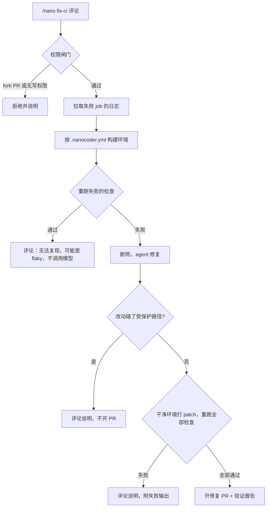

# nanocoder v0.2：CI 修复机器人设计

> 状态：设计稿，2026-11-05。还没有写代码。
> 一句话：PR 的 CI 红了，nanocoder 在隔离环境里复现、修复，并由 runner 重新跑一遍确认变绿，才开一个修复 PR。

## 1. 为什么这样设计：来自 10 道失败题的结论

SWE-bench 50 题里失败的 10 题，逐题对照 issue、官方修复、隐藏测试和 agent 的 patch 后（见 `P2-coding-agent.md` 第 16 节），结果如下：

| 类型 | 题数 | 含义 | 对 CI 修复的影响 |
|---|---|---|---|
| 验收要求超出 issue | 6 | 隐藏测试检查 issue 没写的内部 API 或上游设计选择 | 基本消失：失败的测试就在日志里，agent 看得到 |
| 修复不完整或位置不对 | 3 | issue 说清了问题，修得不够 | 大部分能暴露：失败的检查还红着，agent 不能交差 |
| 看到失败却排除 | 1 | agent 看到 5 个测试失败，用 `-k` 排除后提交 | 必须在代码层堵住，见 3.1 |

所以有两条设计原则：

1. **提交由 runner 判定，不由模型判定。** 现在的提交守卫只检查“编辑后跑过 python 或 pytest”，astropy 那题完全符合，matplotlib 那题也排除过一个失败测试。CI 修复里，由 runner 在干净环境里重跑配置好的检查命令。
2. **失败的检查本身就是规格。** 这是 CI 修复比 issue 修复更适合 agent 的原因。

## 2. 范围

**MVP 要做**：Python 仓库；同仓库分支上的 PR；测试、lint、类型检查类失败；用 GitHub Action 运行；评论 `/nano fix-ci` 触发；开修复 PR，并附由执行记录生成的验证报告。

**MVP 不做**：

- fork 来的 PR（安全原因，见 3.4）；
- CI 失败时自动触发（等 observe 模式跑过之后再开）；
- 依赖升级、需要联网才能修的失败；
- 自托管服务、Web 控制台、其他语言；
- 直接推到别人的 PR 分支。

修不了就在 PR 里留一条评论说明卡在哪，不开 PR。

## 3. 流程



### 3.1 判定闸门（核心）

全部由确定性代码执行，模型无法绕过：

| 闸门 | 时机 | 规则 |
|---|---|---|
| 复现闸门 | agent 启动前 | 检查命令必须失败。通过了说明是 flaky 或环境差异，直接结束，不花 token |
| 路径闸门 | agent 结束后 | diff 不得碰测试文件和 CI 配置（可配置）。违反就拒绝，不静默剔除 |
| 变绿闸门 | agent 结束后 | 把 patch 打到新容器，跑 `.nanocoder.yml` 里的**全部**检查，退出码都是 0 才算成功 |

`patch.py` 现在会静默剔除测试文件的改动，这适合 SWE-bench，但不适合这里：修复可能正依赖被剔除的改动。CI 模式改为直接拒绝。

`bash` 工具什么文件都能改，所以路径限制放在工具层只能算提示，真正的约束是路径闸门。

### 3.2 环境

MVP 不猜环境，由用户写配置：

```yaml
# .nanocoder.yml
image: python:3.12
setup:
  - pip install -e ".[test]"
checks:
  - name: test            # 对应 CI 的 job 名
    command: pytest -q
  - name: lint
    command: ruff check .
protected_paths:          # 可选，默认保护测试文件和 .github/
  - tests/**
  - .github/**
limits:
  max_input_tokens: 600000
  max_steps: 40
```

容器联网执行 `setup`，然后 `docker network disconnect`，agent 全程断网。`DockerSandbox` 要新增：把仓库复制进容器，以及断网这一步。SWE-bench 的镜像已预装依赖，不需要这些。

### 3.3 交付

- 分支 `nanocoder/fix-<短 sha>`，PR 的目标是失败的那个分支，由人决定是否合并。
- 用户配置细粒度 PAT（secret `NANOCODER_TOKEN`，权限 contents 和 pull requests 写）。[GitHub 文档](https://docs.github.com/en/actions/concepts/security/github_token)说明，用 `GITHUB_TOKEN` 推送不会触发新的 workflow，也就看不到修复 PR 的 CI 结果。以后可以换成 GitHub App。
- 验证报告由执行记录生成，不用模型自述：修复前的命令和失败输出、修复后每条检查的退出码、改动文件、步数和 token、运行配置指纹。模型只写“改了什么、为什么”，并标明是模型的说明。
- 防循环：作者是 nanocoder 的 PR 不处理；同一个 commit 只处理一次。

### 3.4 安全

| 风险 | 做法 |
|---|---|
| fork PR 窃取 secret | MVP 直接拒绝。[GitHub 明确警告](https://docs.github.com/en/enterprise-server@3.20/actions/reference/security/secure-use)特权触发器不能检出不可信代码，也见 [Security Lab 的 pwn requests 说明](https://securitylab.github.com/research/github-actions-preventing-pwn-requests) |
| 任意人评论触发 | 只接受有写权限的用户，命令由确定性代码解析 |
| 日志、代码里的提示注入 | 日志当作数据传给模型；agent 容器断网、没有 token；交付由容器外的代码执行 |
| key 泄露 | LLM key 和 GitHub token 只在容器外的进程里，不传入容器 |
| 用改测试的方式变绿 | 路径闸门 |

`setup` 和检查命令会执行 PR 里的代码，但都在容器里，且容器内没有 secret。

### 3.5 成本

现在的 `cost_limit` 是按已下架的 luna 单价算的美元，不可靠。改为按输入 token 设上限。按 terra 平均每题 19.7 万输入 token，默认上限先定 60 万。复现闸门也能省钱：flaky 不调用模型。

## 4. 代码改动

| 模块 | 改动 |
|---|---|
| `agent.py` | 新增 token 上限；可替换的任务模板 |
| `prompts.py` | CI 修复提示词：日志是数据，不得排除或跳过测试 |
| `docker_sandbox.py` | 复制仓库进容器，`setup` 后断网 |
| `patch.py` | CI 模式下检测受保护路径并拒绝，不剔除 |
| 新增 `cifix/config.py` | 读取并校验 `.nanocoder.yml` |
| 新增 `cifix/gates.py` | 三道闸门 |
| 新增 `cifix/logs.py` | 从失败日志截取关键部分 |
| 新增 `cifix/report.py` | 验证报告 |
| 新增 `cifix/github.py` | 取日志、权限检查、开 PR、评论 |
| 新增 `action.yml` | GitHub Action 入口 |
| 新增 `bench/ci_run.py` | CI 修复评测 |

agent 循环、工具、Responses API 和 trace 直接复用。之前列的小改进这样落地：A1 禁改测试 → 路径闸门；A3 配置指纹 → 写入运行记录和报告；A2 危险命令黑名单先不做，agent 在断网容器里，没有 secret，优先级低。

## 5. 评测

**任务集**：从开源 Python 仓库的 GitHub Actions 历史里找“某 commit CI 红，下一个 commit 修绿”的提交对，先做 20 题，只保留失败能在容器里复现、修复提交没有改测试的。JetBrains 的 CI builds repair 基准和 BugSwarm 可能可以参考，这两个是凭记忆提的，用之前要核实。

**指标**：

| 指标 | 说明 |
|---|---|
| 变绿率 | 通过变绿闸门的比例，主指标 |
| 误交付率 | 变绿但人工判断修法不对的比例，从变绿的题里全部人工抽查 |
| 拦截分布 | 被哪道闸门拦下，用来发现 agent 想绕过检查的情况 |
| 单题 token、耗时 | |

**重要的局限**：CI 变绿不等于修对了，比如删掉断言之外还有放宽校验、吞掉异常等办法。所以需要人工抽查，也需要真实的合并率。

**真实使用**：在你自己的 2～3 个仓库上试用，记录修复 PR 的合并率。这比跑分更有说服力。

## 6. 里程碑

| 里程碑 | 内容 | 完成标准 | API 花费 |
|---|---|---|---|
| M0 本地 CLI | `nanocoder fix-ci --config .nanocoder.yml --log ci.log`；三道闸门；报告 | 闸门单元测试通过；用 1 个人造仓库跑通，包括 flaky、改测试、未修好三种拦截 | 约 1 题 |
| M1 评测 | 任务集 20 题和基线 | 有变绿率、拦截分布和人工抽查结果 | 约 400 万输入 token，开跑前确认 |
| M2 GitHub Action | 评论触发、取日志、开 PR、评论 | 在一个测试仓库上走通全流程 | 约几题 |
| M3 真实试用 | 你自己的仓库 | 有真实修复 PR 和合并记录 | 按实际 |

M0 不依赖 GitHub，闸门能先被验证；M1 排在 M2 前面，先知道它修得怎么样，再接入。

## 7. 还没定的事

- **测试仓库**：M2、M3 需要一个可以放心试的 GitHub 仓库。`gh` 登录现在是失效的，需要先 `gh auth refresh -h github.com`。
- **日志截取策略**：长日志要截多少才够，等 M1 用数据决定。
- **模型单价**：terra 的实际单价未知，要看中转站后台。
